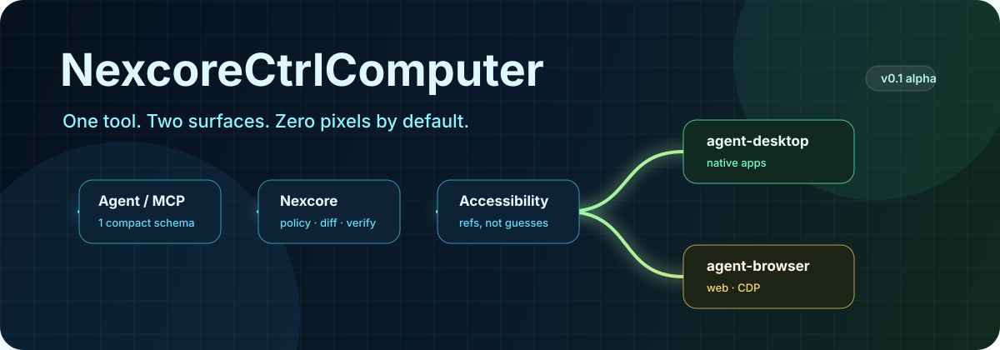

<p align="center">
  
</p>

<h1 align="center">NexcoreCtrlComputer</h1>

<p align="center">
  <strong>The missing control plane for computer-use agents.</strong><br>
  Accessibility-first. One MCP tool. Verified actions. Far fewer visual tokens.
</p>

<p align="center">
  <a href="https://github.com/yan-stone-computer/NexcoreCtrlComputer/actions/workflows/ci.yml"></a>
  
  
  
  
</p>

> Your agent does not need a 4K screenshot to click a button called "Save".

Most computer-use stacks send pixels, coordinates, and tool schemas back and
forth until the token bill becomes the product. NexcoreCtrlComputer treats the
OS accessibility tree as the primary API, keeps short-lived element refs, and
adds one reusable control plane above **agent-desktop**, **agent-browser**, and
an explicitly gated **PyAutoGUI** fallback.

## Why this exists

| Problem | Nexcore's answer |
|---|---|
| Screenshots are expensive and ambiguous | Semantic role/name/ref snapshots |
| Coordinates break when DPI or layout changes | Accessibility-first actions |
| Dozens of tools bloat agent context | One `computer` MCP tool |
| `ok: true` does not prove the UI changed | Optional post-action `expect` |
| Dense apps overflow context | Node caps, exact queries, drill-down refs |
| Blind retries double-click real controls | Backend retry disposition is preserved |
| Pixel automation is unsafe by default | Headed and coordinate modes are opt-in |
| Every agent reimplements backend quirks | One normalized JS/CLI/MCP contract |

## 30-second demo

```bash
git clone https://github.com/yan-stone-computer/NexcoreCtrlComputer.git
cd NexcoreCtrlComputer
npm install
npm link
npm install -g agent-desktop agent-browser
python -m pip install pyautogui                          # optional fallback
nexcore doctor

nexcore observe '{"surface":"desktop","app":"Calculator","query":"7"}'
nexcore act '{"surface":"desktop","app":"Calculator","action":"click","target":{"role":"button","name":"7"}}'
```

Desktop refs look like this:

```text
desktop app "Calculator"
@sabc123:e1 textfield "Display" = "0" {enabled} [setvalue,focus]
@sabc123:e2 button "7" [click]
```

A browser run looks like this:

```bash
nexcore act '{
  "surface": "browser",
  "url": "https://example.com",
  "action": "click",
  "target": {"role":"link","name":"Learn more"},
  "expect": {
    "property": "url",
    "value": "https://www.iana.org/help/example-domains"
  }
}'
```

The second step opens the page, finds the exact semantic target, clicks it, and
verifies navigation. No screenshot is sent to the model.

## One tool, not fifty

`nexcore mcp` exposes a single `computer` tool over stdio:

```json
{
  "mcpServers": {
    "nexcore": {
      "command": "nexcore",
      "args": ["mcp"],
      "env": {
        "NEXCORE_SESSION": "default",
        "NEXCORE_ALLOWED_APPS": "Calculator,notepad.exe",
        "NEXCORE_ALLOWED_DOMAINS": "example.com"
      }
    }
  }
}
```

Modes: `status`, `observe`, `act`, `run`, `close`.

Actions: open, click, double-click, right-click, hover, focus, fill, type,
press, select, check, uncheck, toggle, expand, collapse, scroll, coordinate
click, and screenshot.

This keeps the tool catalog stable while the agent performs multi-step work:

```json
{
  "mode": "run",
  "steps": [
    {
      "observe": {
        "surface": "desktop",
        "app": "Calculator",
        "query": "7"
      }
    },
    {
      "act": {
        "surface": "desktop",
        "app": "Calculator",
        "action": "click",
        "target": {
          "role": "button",
          "name": "7"
        }
      }
    }
  ]
}
```

## Use it from JavaScript

Link the local open-source package into your project:

```bash
cd NexcoreCtrlComputer
npm link
cd ../your-agent-project
npm link nexcorectrlcomputer
```

```js
import { createComputer } from "nexcorectrlcomputer";

const computer = await createComputer({
  session: "checkout-audit",
  policy: {
    allowedApps: ["Calculator"],
    allowedDomains: ["example.com"],
    allowHeaded: false,
    allowCoordinates: false
  }
});

const view = await computer.observe({
  surface: "browser",
  url: "https://example.com"
});

console.log(view.text);
console.log(view.estimatedTokens);

await computer.act({
  surface: "browser",
  action: "click",
  target: { role: "link", name: "Learn more" }
});

await computer.verify({
  surface: "browser",
  property: "url",
  value: "https://www.iana.org/help/example-domains"
});

await computer.close();
```

The same API can be mounted inside OpenAI Responses function calling, LangGraph,
AutoGen, CrewAI, Claude, Codex, or a custom MCP client.

## Token reduction without hand-waving

The included fixture benchmark compares raw pretty-printed accessibility JSON
with Nexcore's compact observation:

```bash
npm run bench
```

```text
30-node synthetic accessibility tree
raw:     8,406 bytes  (~2,102 estimated tokens)
compact: 2,155 bytes    (~539 estimated tokens)
reduction: 74.4%
```

These are UTF-8 byte and `bytes / 4` estimates on a synthetic fixture, not a
provider bill. Real savings depend on tree density and how narrowly you query.
The larger win is architectural: screenshots stay local unless visual grounding
is genuinely necessary.

## Observe -> act -> verify

1. Observe the smallest useful region.
2. Act on a fresh accessibility ref or exact semantic target.
3. Verify a value, state, or URL when the action matters.
4. Retry only when the backend says retry is safe.

```js
const result = await computer.act({
  surface: "desktop",
  app: "Calculator",
  action: "click",
  target: "@sabc123:e2",
  expect: {
    property: "value",
    value: "7",
    timeoutMs: 3000
  }
});
```

Actions are not blindly replayed. A click may already have landed; backend
disposition prevents duplicate input.

## Safety model

- Desktop and browser actions use semantic APIs before physical input.
- Headed input is denied unless `allowHeaded` is true.
- Coordinates are denied unless `allowCoordinates` is true.
- App and domain allowlists are supported.
- PyAutoGUI keeps its corner fail-safe enabled.
- Backend output is treated as untrusted content.
- `nexcore close` closes the browser session, not the user's applications.
- Secrets should stay out of prompts, traces, screenshots, and process args.

See [SECURITY.md](./SECURITY.md) before unattended use.

## Install backends

Nexcore has zero npm runtime dependencies. The specialist engines are optional,
separately versioned backends:

```bash
npm install agent-desktop agent-browser
python -m pip install -r requirements-coordinate.txt
```

Environment overrides:

```text
NEXCORE_DESKTOP_BIN       absolute backend path
NEXCORE_BROWSER_BIN       absolute backend path
NEXCORE_PYTHON_BIN        Python executable
NEXCORE_SESSION           isolated session name
NEXCORE_ALLOW_HEADED      "1" to enable physical input
NEXCORE_ALLOW_COORDINATES "1" to enable PyAutoGUI coordinate actions
NEXCORE_ALLOWED_APPS      comma-separated desktop allowlist
NEXCORE_ALLOWED_DOMAINS   comma-separated browser allowlist
```

## Status

Validated on Windows with Node 24, `agent-desktop` 1.2.0,
`agent-browser` 0.42.0, and PyAutoGUI 0.9.54:

- accessibility grant and backend doctor
- live desktop snapshot and value verification
- live browser click and URL verification
- MCP protocol smoke test
- unit tests for compaction, diffing, and policy

macOS and Linux support comes through the same upstream accessibility engines,
but is not yet covered by this repository's live CI. Contributions that run real
platform checks are especially valuable.

## Related projects

NexcoreCtrlComputer is independent and does not vendor upstream source:

- [agent-desktop](https://github.com/vercel-labs/agent-desktop) - native
  accessibility snapshots and actions, Apache-2.0
- [agent-browser](https://github.com/vercel-labs/agent-browser) - browser
  automation and CDP snapshots, Apache-2.0
- [PyAutoGUI](https://github.com/asweigart/pyautogui) - coordinate input and
  screenshot fallback, BSD-3-Clause

See [NOTICE](./NOTICE) for the integration boundary.

## Contributing

The best contribution is a smaller round trip, a safer failure, or a real
platform verification. Read [CONTRIBUTING.md](./CONTRIBUTING.md), run `npm test`,
and include evidence from a live backend when changing adapter arguments.

If this saves your agent from one screenshot loop, star the repo and bring your
hardest computer-use workflow.
