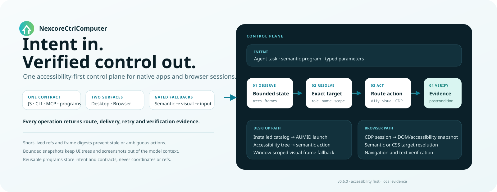
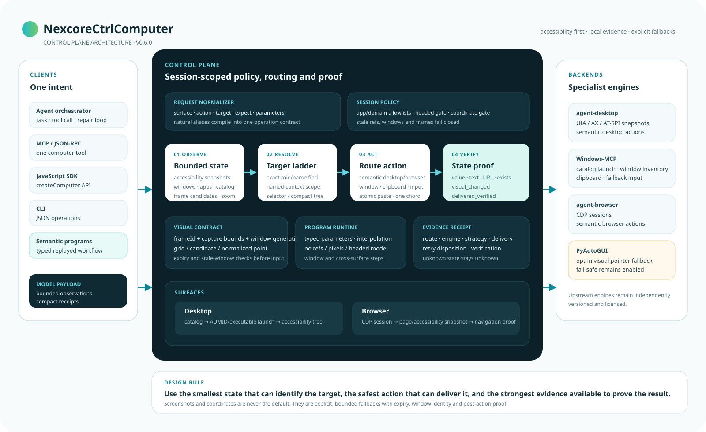

<p align="center">
  
</p>

<h1 align="center">NexcoreCtrlComputer</h1>

<p align="center">
  <strong>观察、执行，并证明界面真的变了。</strong><br>
  一个面向原生桌面和浏览器会话的无障碍优先控制内核。
</p>

> Agent 不需要一张 4K 截图，才能点击一个叫“保存”的按钮。

NexcoreCtrlComputer 是 NexcoreWork 使用的开源电脑控制内核。它用统一的
JS/CLI/MCP 契约控制桌面和浏览器，在本地完成无障碍目标定位，验证关键后置条件，
并返回紧凑回执，而不是把截图和完整控件树反复发给模型。

它既可以执行一次语义动作，也可以保存参数化 UI 程序。底层使用
**agent-desktop**、**Windows-MCP**、**agent-browser** 和显式开启的 PyAutoGUI
兜底；它不是一个独立的桌面软件。

## 0.6.0 增加了什么

`0.6.0` 将公开仓库同步到 NexcoreWork 2.5.9 实际使用的电脑控制内核，并把
软件启动和长任务能力写进正式架构：

- 已安装软件按准确的可执行文件路径或 `shell:AppsFolder` AUMID 启动；
  只有目录身份不可用时才回退到 Windows-MCP，不再猜进程名。
- `window_focus`、`window_resize`、`window_minimize`、`window_maximize`、
  `window_restore` 可以作为语义程序步骤复用。
- 包内正式提供 TypeScript 声明，覆盖 computer、policy、program、observation、
  action 和 verification 接口。
- 架构文档从旧的“后端堆叠图”升级为一条完整控制平面：有界观察、目标解析、
  执行路由、后置验证和证据回执。
- README 主图与架构图全部替换为 0.6 版本。

## 0.5.1 增加了什么

`0.5.1` 修复长时间电脑操作任务的两个断点：

- `observe({ view: "visual", windowId })` 或 `windowTitle` 只截目标窗口，归一化
  坐标按窗口 bounds 映射；执行前确认窗口仍存在且没有移动、缩放。
- 新增原子 `paste`：一次调用完成点击、写剪贴板、发送一次 `Ctrl+V` 和画面变化
  验证，适合 WebView、Canvas 等没有可靠编辑控件的位置。
- `["CTRL", "V"]` 作为一个组合键发送，不再被拆成两次单键。
- 增加 `minimize`、`maximize`、`restore` 自然别名，并过滤菜单、容器等低价值视觉候选。

## 0.5.0 增加了什么

`0.5.0` 增加受控的视觉帧兜底，专门处理 Canvas、游戏、远程桌面和没有可用
无障碍树的自绘界面：

- `observe({ view: "visual" })` 可抓取全桌面或指定窗口帧，并生成紧凑 MCP 预览。
- 每个动作绑定 30 秒有效的 SHA-256 `frameId`，窗口发生变化后拒绝执行。
- 网格和归一化坐标通过显示器 bounds/DPI 映射到物理像素。
- 可用无障碍 bounds 生成带编号的视觉候选框，再对可疑区域继续放大。
- `click`、`double_click`、`right_click`、`hover` 可直接使用 `{ frameId, cell }`。
- 没有语义后置条件时，可用 `expect.property="visual_changed"` 对比动作前后截图。
- 原始 PNG 保留用于局部放大，MCP 默认只收到 1600px JPEG 预览。

## 0.4.1 增加了什么

`0.4.1` 在 `0.4.0` 的 Windows 分层回退之上，增加已安装软件发现和适配器注册表：

- `observe({ view: "software" })` 列出 Start Menu 中可启动的软件、准确名称和
  AUMID，与只表示正在运行应用的 `apps` 明确分开。
- `observe({ view: "adapters" })` 报告桌面、浏览器、视觉、录制回放和本机 CLI
  适配器；可选项目不会伪装成已经安装。
- 软件结果携带 `launchAdapter` 与 `controlAdapters`，智能体可以按准确名称启动，
  再选择相应的语义控制路线。
- 主桌面后端不可用时，可由 `Windows-MCP` 启动应用、抓取桌面/窗口状态、
  解析控件标签、模拟输入并等待文本。
- 回退仍走同一个 JS/CLI/MCP 契约，并返回相同的路由、投递和验证回执。
- `0.3.0` 的“浏览器状态不能劫持桌面清单”修复继续生效。

`0.3.0` 修复了网页会话“粘住”，导致后续桌面操作仍然跑进浏览器的问题：

- `observe` 支持 `windows`、`apps`、`displays`、`notifications`、`surfaces`
  五种桌面清单视图。
- 桌面清单始终回到桌面通道，不受之前的浏览器任务影响。
- 窗口聚焦会恢复最小化窗口，并在 Windows 前台锁拦截时重试。
- 窗口管理和剪贴板读写进入统一动作契约。
- `property=text` 读取真实无障碍文本，不再把“元素存在”冒充文本验证。
- 每个动作都能返回路由、投递、重试和验证回执。

本仓库的 Windows 真机测试会打开系统计算器、观察无障碍控件、点击“七”按钮，
并验证显示文字为“显示为 7”。

## 为什么值得用

| 传统方案 | Nexcore |
|---|---|
| 同一流程每次重新规划 | 参数化语义程序 |
| 桌面和浏览器步骤只存在 prompt 里 | 一个跨端可执行制品 |
| 截图贵且存在歧义 | 角色、名称、引用的语义快照 |
| DPI 或布局一变坐标就失效 | 无障碍优先的语义动作 |
| 工具太多挤占上下文 | 只暴露一个 `computer` 工具 |
| `ok: true` 不代表页面真的变了 | 可选 `expect` 后置验证 |
| 复杂应用快照爆炸 | 节点上限、精确查询、区域钻取 |
| 重试可能重复点击 | 保留底层安全重试策略 |
| 像素操控默认风险高 | 带界面/坐标模式默认关闭 |

## 真正的新能力

语义程序只保存意图和契约，不保存截图、坐标或一次性 ref：

```json
{
  "schema": "nexcore.program/v1",
  "name": "browser.fill",
  "version": "1.0.0",
  "params": {
    "value": { "type": "string", "required": true }
  },
  "steps": [
    {
      "act": {
        "surface": "browser",
        "action": "fill",
        "target": { "role": "textbox", "name": "Name" },
        "text": "{{value}}",
        "expect": { "property": "value", "value": "{{value}}" }
      }
    }
  ]
}
```

```bash
nexcore program save ./examples/programs/browser-fill.json
nexcore program run browser.fill '{"value":"Ada"}'
```

模型不再重复发送步骤：

```json
{
  "mode": "program_run",
  "programName": "browser.fill",
  "params": { "value": "Ada" }
}
```

每次重放都会重新解析目标：桌面先尝试精确无障碍查找，再用命名上下文限定区域，
最后才读取紧凑快照；浏览器支持语义目标和 CSS selector。所有后置条件必须通过，
已经投递但无法证明结果的危险动作不会被自动重试。

完整规则见 [程序规范](./docs/PROGRAMS.md)。

真实用户口吻的黑盒测试清单见
[docs/TEST-CASES.zh-CN.md](./docs/TEST-CASES.zh-CN.md)。
最新五轮 Windows 前台真机测试报告见
[docs/LIVE-TEST-REPORT-2026-11-15.md](./docs/LIVE-TEST-REPORT-2026-11-15.md)。

## 架构



架构按五层契约拆分：

| 层级 | 职责 | 失败边界 |
|---|---|---|
| 客户端 | Agent、MCP、JS、CLI 或语义程序表达意图 | 后端细节不泄漏给模型 |
| 控制平面 | 规范化、会话策略、观察、解析、路由、验证与回执 | 操作契约和策略校验 |
| 目标定位 | 无障碍快照、软件目录、浏览器状态、视觉帧 | 过期 ref、窗口和帧直接拒绝 |
| 执行 | 桌面/浏览器语义动作、窗口、剪贴板、输入与受控兜底 | 无法证明结果时不做危险重放 |
| 证据 | 值、文本、URL、存在性或 `visual_changed` | 未知保持未知，不伪装成功 |

桌面和浏览器状态始终显式区分；之前的浏览器会话不会偷偷接管后续的
`observe({ view: "windows" })`。截图不会因为“能截”就升级成默认路径。

## 该用哪个观察接口？

| 目标 | 调用 |
|---|---|
| 查找已打开的桌面窗口 | `observe({ view: "windows" })` |
| 列出正在运行的桌面应用 | `observe({ view: "apps" })` |
| 列出已安装且可启动的软件与 AUMID | `observe({ view: "software" })` |
| 查看计算器控件 | `observe({ app: "CalculatorApp.exe", query: "7" })` |
| 继续操作当前网页 | `observe({ surface: "browser" })` |
| 打开网页并观察 | `observe({ surface: "browser", url: "https://..." })` |
| 查看当前可用控制引擎 | `observe({ view: "adapters" })` |
| 没有可靠无障碍树时定位控件 | `observe({ view: "visual" })` |

## 三步跑起来

```bash
git clone https://github.com/yan-stone-computer/NexcoreCtrlComputer.git
cd NexcoreCtrlComputer
npm install
npm link
npm install -g agent-desktop agent-browser
python -m pip install pyautogui                         # 可选兜底
nexcore doctor
```

桌面观察：

```bash
nexcore observe '{"view":"windows"}'
nexcore observe '{"view":"apps"}'
nexcore observe '{"surface":"desktop","app":"Calculator","query":"7"}'
```

浏览器点击并验证跳转：

```bash
nexcore act '{
  "surface":"browser",
  "url":"https://example.com",
  "action":"click",
  "target":{"role":"link","name":"Learn more"},
  "expect":{"property":"url","value":"https://www.iana.org/help/example-domains"}
}'
```

整个过程不把截图发送给模型，目标通过角色和名称精确定位。

## 一个工具，而不是几十个

```json
{
  "mcpServers": {
    "nexcore": {
      "command": "nexcore",
      "args": ["mcp"],
      "env": {
        "NEXCORE_SESSION": "default",
        "NEXCORE_ALLOWED_APPS": "Calculator,notepad.exe",
        "NEXCORE_ALLOWED_DOMAINS": "example.com"
      }
    }
  }
}
```

支持 `status`、`observe`、`act`、`run`、`program_save`、`program_list`、
`program_run`、`close`。动作涵盖点击、输入、按键、选择、勾选、展开、滚动、
窗口管理和剪贴板读写。软件清单会返回准确的 `launch` 描述，`appId` 可直接打开
AUMID 或可执行文件；语义程序可包含窗口焦点、缩放、最小化、最大化和恢复动作，
但仍拒绝一次性 ref、像素坐标和 headed 模式。桌面 `observe` 可直接查看 windows、apps、displays、
notifications、surfaces；这些视图会明确回到桌面通道，不会被之前的浏览器会话
劫持。截图和坐标点击只能作为显式的一次性动作，不能写进可复用程序。

## JS API

```bash
cd NexcoreCtrlComputer
npm link
cd ../your-agent-project
npm link nexcorectrlcomputer
```

```js
import { createComputer } from "nexcorectrlcomputer";

const computer = await createComputer({
  session: "demo",
  policy: {
    allowedApps: ["Calculator"],
    allowedDomains: ["example.com"],
    allowHeaded: false,
    allowCoordinates: false
  }
});

const view = await computer.observe({
  surface: "browser",
  url: "https://example.com"
});
console.log(view.text, view.estimatedTokens);

await computer.act({
  surface: "browser",
  action: "click",
  target: { role: "link", name: "Learn more" }
});

await computer.close();
```

## 实测压缩

```text
30 个节点的合成无障碍树
原始 JSON: 8,406 bytes  (~2,102 估算 token)
压缩快照: 2,155 bytes    (~539 估算 token)
减少: 74.4%

两步浏览器计划
内联计划:  213 bytes  (~54 估算 token)
程序调用:   85 bytes  (~22 估算 token)
减少: 60.1%
```

这是固定测试夹具上的 UTF-8 字节与 `bytes / 4` 估算，不等同于模型账单；
实际收益取决于界面密度和查询范围。真正的大头是让截图默认留在本地。

## 安全默认值

- 默认禁止物理界面输入。
- 默认禁止坐标点击。
- 支持应用和域名白名单。
- PyAutoGUI 保留屏幕角落紧急停止。
- 失效引用必须失败，不能猜一个长得像的控件。
- `nexcore close` 不会关闭用户正在使用的其他应用。
- 程序会拒绝 ref、坐标、截图、Headed 和任意脚本字段。

详细说明见 [SECURITY.md](./SECURITY.md)。

## 架构边界

Nexcore 自己负责编排、压缩、策略、验证和协议适配；系统无障碍与 CDP 能力由
专业后端负责。项目不复制三份上游源码，而是通过稳定 CLI 契约组合能力，并在
[NOTICE](./NOTICE) 中明确许可证和用途。

Windows 上已经完成真实桌面快照、桌面值验证、浏览器点击、URL 验证、语义程序
重放和跨桌面/浏览器程序测试。macOS 与 Linux 复用同一后端抽象，但欢迎补充
真实平台 CI。

如果这个项目帮你省掉了一轮截图循环，给一个 Star，并带着最难的电脑操控流程
来提 Issue。
