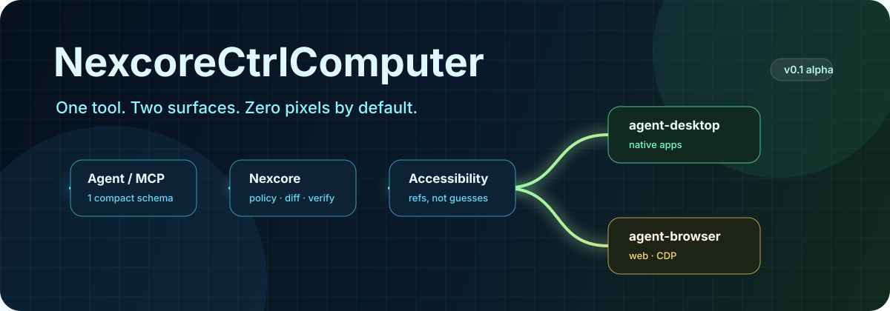
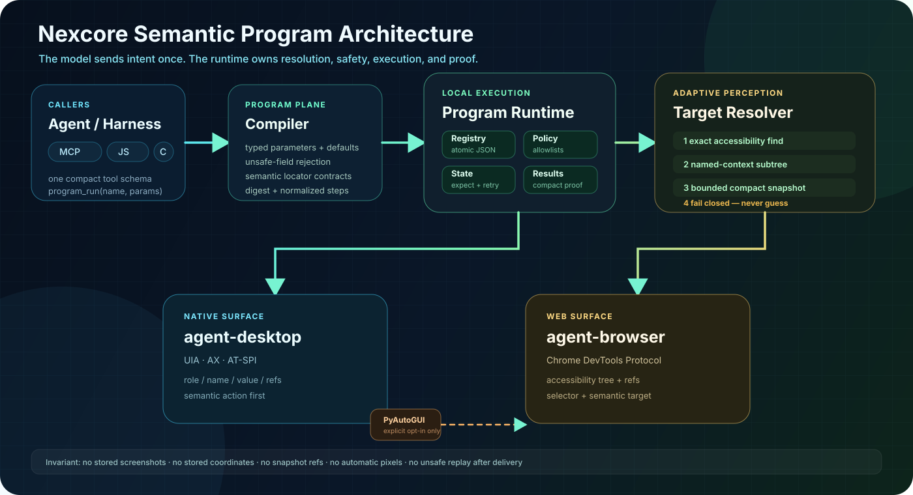

<p align="center">
  
</p>

<h1 align="center">NexcoreCtrlComputer</h1>

<p align="center">
  <strong>编译一次，跨桌面和浏览器复用。</strong><br>
  语义 UI 程序、本地精确寻址、可验证重放。
</p>

> Agent 不需要一张 4K 截图，才能点击一个叫“保存”的按钮。

很多电脑操控框架每次都把截图、坐标和同一套多步计划重新发给模型，延迟高、
token 贵，窗口变化还会点错。NexcoreCtrlComputer 引入了新的核心抽象：可参数化
的语义 UI 程序。跨端流程只编译一次，之后由本地运行时重新寻址、执行和验证，
模型只收到一个紧凑结果。

底层能力来自 **agent-desktop**、**agent-browser** 和显式开启的
**PyAutoGUI** 兜底；真正沉淀下来的资产是你的程序和状态契约，而不是截图或
一次性 prompt。

## 为什么值得用

| 传统方案 | Nexcore |
|---|---|
| 同一流程每次重新规划 | 参数化语义程序 |
| 桌面和浏览器步骤只存在 prompt 里 | 一个跨端可执行制品 |
| 截图贵且存在歧义 | 角色、名称、引用的语义快照 |
| DPI 或布局一变坐标就失效 | 无障碍优先的语义动作 |
| 工具太多挤占上下文 | 只暴露一个 `computer` 工具 |
| `ok: true` 不代表页面真的变了 | 可选 `expect` 后置验证 |
| 复杂应用快照爆炸 | 节点上限、精确查询、区域钻取 |
| 重试可能重复点击 | 保留底层安全重试策略 |
| 像素操控默认风险高 | 带界面/坐标模式默认关闭 |

## 真正的新能力

语义程序只保存意图和契约，不保存截图、坐标或一次性 ref：

```json
{
  "schema": "nexcore.program/v1",
  "name": "browser.fill",
  "version": "1.0.0",
  "params": {
    "value": { "type": "string", "required": true }
  },
  "steps": [
    {
      "act": {
        "surface": "browser",
        "action": "fill",
        "target": { "role": "textbox", "name": "Name" },
        "text": "{{value}}",
        "expect": { "property": "value", "value": "{{value}}" }
      }
    }
  ]
}
```

```bash
nexcore program save ./examples/programs/browser-fill.json
nexcore program run browser.fill '{"value":"Ada"}'
```

模型不再重复发送步骤：

```json
{
  "mode": "program_run",
  "programName": "browser.fill",
  "params": { "value": "Ada" }
}
```

每次重放都会重新解析目标：桌面先尝试精确无障碍查找，再用命名上下文限定区域，
最后才读取紧凑快照；浏览器支持语义目标和 CSS selector。所有后置条件必须通过，
已经投递但无法证明结果的危险动作不会被自动重试。

完整规则见 [程序规范](./docs/PROGRAMS.md)。

## 架构



模型只提交意图；本地运行时负责持久化程序、逐级目标定位、安全策略、动作执行和
状态证明。

## 三步跑起来

```bash
git clone https://github.com/yan-stone-computer/NexcoreCtrlComputer.git
cd NexcoreCtrlComputer
npm install
npm link
npm install -g agent-desktop agent-browser
python -m pip install pyautogui                         # 可选兜底
nexcore doctor
```

桌面观察：

```bash
nexcore observe '{"surface":"desktop","app":"Calculator","query":"7"}'
```

浏览器点击并验证跳转：

```bash
nexcore act '{
  "surface":"browser",
  "url":"https://example.com",
  "action":"click",
  "target":{"role":"link","name":"Learn more"},
  "expect":{"property":"url","value":"https://www.iana.org/help/example-domains"}
}'
```

整个过程不把截图发送给模型，目标通过角色和名称精确定位。

## 一个工具，而不是几十个

```json
{
  "mcpServers": {
    "nexcore": {
      "command": "nexcore",
      "args": ["mcp"],
      "env": {
        "NEXCORE_SESSION": "default",
        "NEXCORE_ALLOWED_APPS": "Calculator,notepad.exe",
        "NEXCORE_ALLOWED_DOMAINS": "example.com"
      }
    }
  }
}
```

支持 `status`、`observe`、`act`、`run`、`program_save`、`program_list`、
`program_run`、`close`。动作涵盖点击、输入、按键、选择、勾选、展开和滚动。
截图和坐标点击只能作为显式的一次性动作，不能写进可复用程序。

## JS API

```bash
cd NexcoreCtrlComputer
npm link
cd ../your-agent-project
npm link nexcorectrlcomputer
```

```js
import { createComputer } from "nexcorectrlcomputer";

const computer = await createComputer({
  session: "demo",
  policy: {
    allowedApps: ["Calculator"],
    allowedDomains: ["example.com"],
    allowHeaded: false,
    allowCoordinates: false
  }
});

const view = await computer.observe({
  surface: "browser",
  url: "https://example.com"
});
console.log(view.text, view.estimatedTokens);

await computer.act({
  surface: "browser",
  action: "click",
  target: { role: "link", name: "Learn more" }
});

await computer.close();
```

## 实测压缩

```text
30 个节点的合成无障碍树
原始 JSON: 8,406 bytes  (~2,102 估算 token)
压缩快照: 2,155 bytes    (~539 估算 token)
减少: 74.4%

两步浏览器计划
内联计划:  213 bytes  (~54 估算 token)
程序调用:   85 bytes  (~22 估算 token)
减少: 60.1%
```

这是固定测试夹具上的 UTF-8 字节与 `bytes / 4` 估算，不等同于模型账单；
实际收益取决于界面密度和查询范围。真正的大头是让截图默认留在本地。

## 安全默认值

- 默认禁止物理界面输入。
- 默认禁止坐标点击。
- 支持应用和域名白名单。
- PyAutoGUI 保留屏幕角落紧急停止。
- 失效引用必须失败，不能猜一个长得像的控件。
- `nexcore close` 不会关闭用户正在使用的其他应用。
- 程序会拒绝 ref、坐标、截图、Headed 和任意脚本字段。

详细说明见 [SECURITY.md](./SECURITY.md)。

## 架构边界

Nexcore 自己负责编排、压缩、策略、验证和协议适配；系统无障碍与 CDP 能力由
专业后端负责。项目不复制三份上游源码，而是通过稳定 CLI 契约组合能力，并在
[NOTICE](./NOTICE) 中明确许可证和用途。

Windows 上已经完成真实桌面快照、桌面值验证、浏览器点击、URL 验证、语义程序
重放和跨桌面/浏览器程序测试。macOS 与 Linux 复用同一后端抽象，但欢迎补充
真实平台 CI。

如果这个项目帮你省掉了一轮截图循环，给一个 Star，并带着最难的电脑操控流程
来提 Issue。
