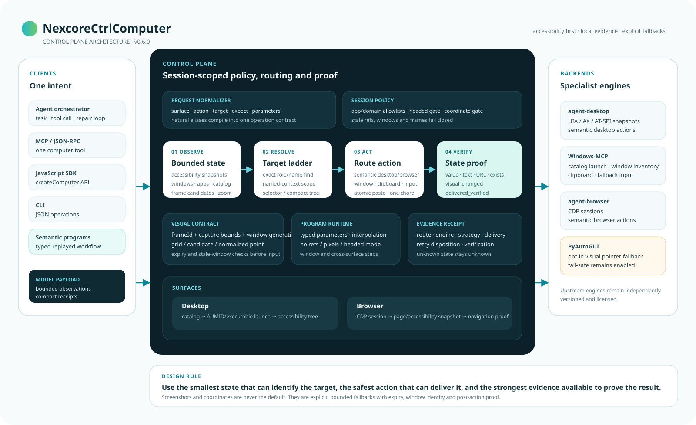

# Architecture



## The question this architecture answers

How can an agent operate a computer without turning every task into a sequence
of screenshots, coordinates, and retries?

NexcoreCtrlComputer answers with one session-scoped control plane. Clients
express an intent; the runtime obtains only the state needed to resolve that
intent, chooses the least physical available route, executes once, verifies the
postcondition, and returns a compact evidence receipt.

```text
agent / MCP / JS / CLI / saved program
                     |
              operation contract
                     |
       +-------------+-------------+
       |       control plane       |
       | normalize -> policy       |
       | observe -> resolve        |
       | route -> act -> verify    |
       | receipt -> next decision  |
       +-------------+-------------+
                     |
        +------------+------------+
        |                         |
     desktop                   browser
  accessibility             CDP + semantic
  software catalog          page snapshot
  window state              selector target
        |                         |
        +------------+------------+
                     |
             guarded visual/input
                  fallback
```

## Five contracts

### 1. Client contract

JavaScript, CLI, and MCP use the same operation surface. Saved programs add
typed parameters and replayable intent, but do not create a second automation
language for the model.

The public modes are `status`, `observe`, `act`, `run`, `program_save`,
`program_list`, `program_run`, and `close`.

### 2. Control-plane contract

Every request is normalized into a bounded operation containing:

- surface, view, action, target, text/value, and optional expectation;
- session identity and policy;
- a compact result budget;
- a retry disposition supplied by the chosen backend.

Natural aliases such as `minimize`, `maximize`, and `restore` normalize before
routing. They are not separate tool names exposed to the model.

### 3. Grounding contract

The target resolver follows an ordered ladder:

1. exact accessibility role/name resolution;
2. named-context scoping when identical names exist in multiple regions;
3. a compact accessibility snapshot with short-lived refs;
4. browser CSS or semantic selectors;
5. a visual candidate/cell/zoom contract only when structure is insufficient.

Installed software is a separate observation from running applications.
Software inventory returns the exact executable path or AUMID needed to launch
the intended application. The runtime no longer guesses a process name when a
catalog identity is available.

### 4. Execution contract

Desktop semantic actions are handled by `agent-desktop`, with `Windows-MCP` as
the explicit Windows fallback for catalog launch, window inventory, clipboard,
and supported input.

Browser work stays inside `agent-browser` and CDP. A page session cannot capture
a later desktop inventory request.

Visual pointer actions and atomic `paste` use PyAutoGUI only when headed and
coordinate modes are enabled. A visual frame records:

- SHA-256 frame identity and expiry;
- capture kind, display identity, and optional window identity;
- capture bounds, physical image size, display bounds, and scale;
- a labeled grid and accessible candidate rectangles.

Before input, the runtime rejects unknown or expired frames, disappeared windows,
changed window bounds, and stale accessibility refs. A point maps through the
captured bounds, not through a mixture of CSS, image, and physical pixels.

### 5. Verification and evidence contract

Important actions can specify `expect`. Supported proof includes value, text,
existence, URL, and `visual_changed`.

The receipt preserves route, engine, strategy, delivery, retry disposition, and
verification. A delivered action that cannot be verified remains
`delivered_unverified`; it is not rewritten as success.

## Semantic programs

Programs store portable intent:

- typed parameters and defaults;
- role/name/context targets;
- browser selectors when no semantic target is stable;
- window-management steps;
- explicit postconditions.

Programs reject screenshot-qualified refs, pixels, coordinate-only targets, and
headed mode. Replay re-grounds every target against the current UI instead of
reusing state from an earlier run.

## Failure boundaries

- Stale refs and frames fail closed.
- A changed active window invalidates visual input.
- Unsafe delivery is not retried automatically.
- Backend output is treated as untrusted data.
- Headed and coordinate input are opt-in.
- App and domain allowlists apply before action execution.
- PyAutoGUI keeps its corner fail-safe.

## Backend ownership

NexcoreCtrlComputer owns orchestration, bounded context, target resolution,
policy, verification, program replay, and protocol adapters.

Platform behavior remains owned by upstream projects:

- `agent-desktop`: native accessibility snapshots and semantic actions;
- `Windows-MCP`: Windows inventory, launch, window, clipboard, and fallback
  interaction semantics;
- `agent-browser`: CDP browser automation;
- `PyAutoGUI`: guarded physical input where semantic APIs cannot operate.

This boundary keeps the project reviewable and avoids silently forking specialist
platform engines.
