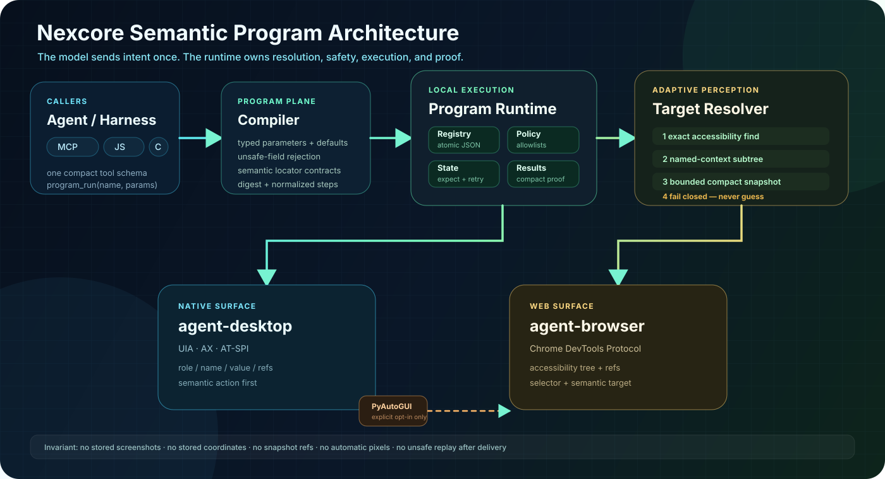

# Architecture



```text
agent / MCP / JS / CLI
          |
      one tool
          |
   semantic program runtime
     | compile + parameters
     | atomic program store
     | adaptive target resolver
  policy -> compact -> verify
          |
  +-------+--------+
  |                |
desktop          browser
agent-desktop    agent-browser
  |                |
UIA / AX / AT-SPI  CDP
          |
   opt-in PyAutoGUI
   coordinate fallback
```

## Decisions

1. Accessibility data is the primary observation because it is semantic,
   deterministic, and much smaller than screenshots.
2. Refs are short-lived handles. A stale ref must fail instead of clicking a
   lookalike.
3. The model sees compact text, not raw backend JSON. Structured data remains
   inside the local process for target resolution and verification.
4. Actions return a small disposition. Expensive verification is explicit via
   `expect`, so routine actions do not pay for an unnecessary round trip.
5. One MCP tool is exposed. The tool's mode and action fields carry the small
   amount of polymorphism required for desktop, browser, and batch execution.
6. Coordinate automation is an exception path, not the default. It is gated by
   policy and protected by PyAutoGUI's corner fail-safe.
7. Reusable automation is stored as semantic program JSON. The source contains
   role/name/context targets and state contracts, never snapshot refs,
   coordinates, or screenshot bytes.
8. Program replay starts with exact accessibility find for desktop targets,
   scopes through a named ancestor when context is required, then falls back to
   bounded snapshots. Visual fallback is never automatic.

## Visual-frame fallback

Visual control is an explicit fallback for surfaces that expose no useful
accessibility tree. `observe({ view: "visual" })` captures one full-desktop PNG,
returns it to MCP clients, and records a short-lived frame contract:

- SHA-256 frame identity and expiry;
- active window identity;
- physical image dimensions, display bounds, and display scale;
- a labeled normalized grid whose cells map safely to physical coordinates.

Accessible controls with bounds are projected into the same frame as numbered
candidate marks. The preview combines the grid and marks, while the model may
select a candidate id, a grid cell, or a normalized point. Dense regions can be
cropped into a second image with a `zoomId`; zoom coordinates map back through
the parent frame before physical input.

Pointer actions accept `{ frameId, cell }` or `{ frameId, normalized }`. Before
input, the runtime rejects unknown/expired frames and frames whose active window
changed. It then maps the normalized point to physical display coordinates and
returns the mapping in the control receipt. The first implementation rejects
app-scoped screenshots because their screen origin has not yet been proven.

When semantic postconditions are unavailable, `visual_changed` compares the
frame hash after the action. This proves that pixels changed, not that the
intended business action succeeded; callers should prefer semantic verification
whenever the app exposes it.

## Backend ownership

NexcoreCtrlComputer owns orchestration, compaction, policy, verification, and
protocol adapters. Platform accessibility and CDP behavior remain owned by the
upstream backends. This keeps the framework small and lets fixes flow from the
specialist projects.
